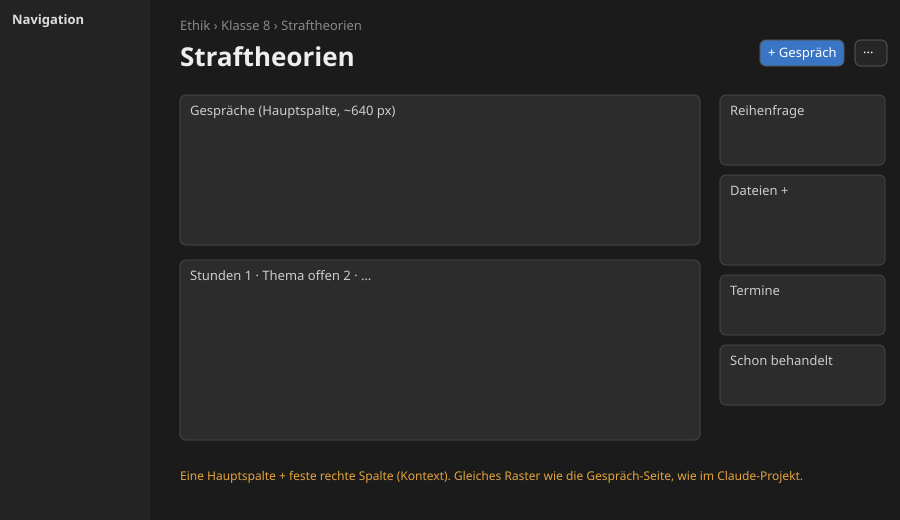
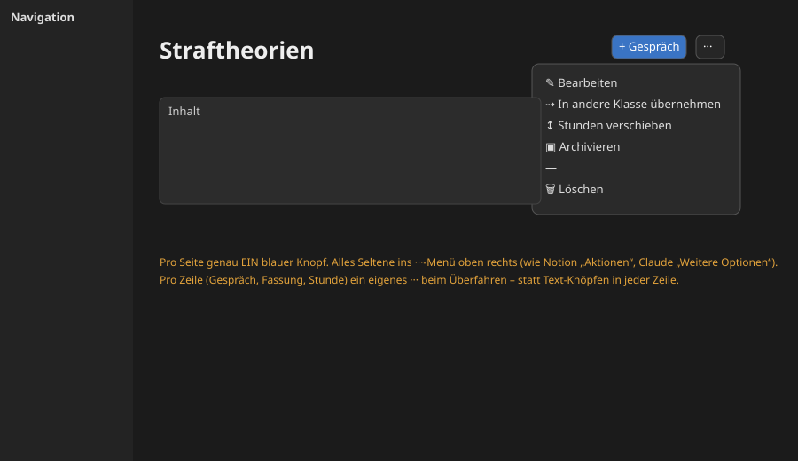
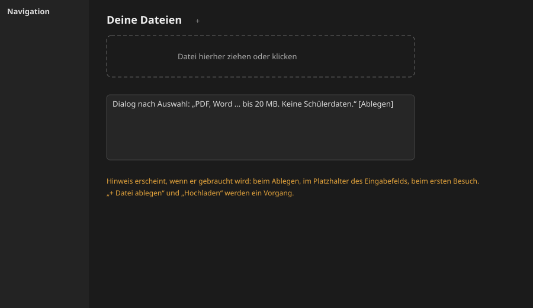
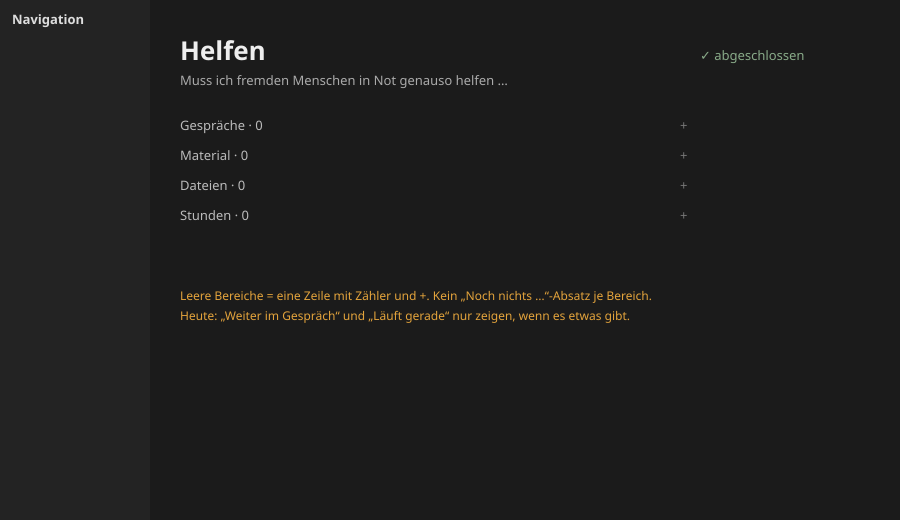
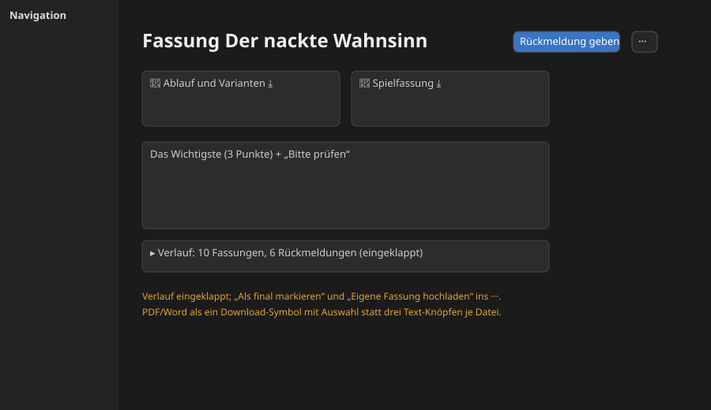

# UX-Befund Lias Oberfläche (lia.meldro.de)

Stand 10.11.2026. Nur angesehen, nichts geändert, nichts abgesendet. Nachtrag desselben Tages (Chat shared/webapp):
Fundstellen im Code (Datei:Zeile, Stand Commit dieses Nachtrags), Korrekturen, ein Alltagsweg nachgeklickt, die zwei
Fehler aus „Nebenbei gefunden“ behoben bzw. weitergegeben. Umbauplan dazu: `umbauplan-ux.md`.

## Was ich nicht ansehen konnte

- **Projektordner fehlte in der ersten Sitzung**. Deshalb standen dort nur CSS-Klassen aus dem Live-DOM. Nachgetragen:
  Spalte „Fundstelle (Code)“ in jeder Tabelle. Pfade relativ zu `shared/webapp/`, Vorlagen in `oberflaeche/`.
- **Alltagswege**: aus Seitenaufbau und DOM abgeleitet. Nachgeklickt (per HTTP auf der Test-Instanz 8795, nicht im
  Browser): „Material für eine Stunde anstoßen“, Ergebnis siehe unten. Die übrigen Wege bleiben abgeleitet.
- **Ein Gespräch mit Nachrichten** gab es auf der Live-Seite nicht, nur ein leeres. Den Gesprächsverlauf konnte ich
  daher nicht bewerten.
- **Linear**: nicht eingeloggt. Als Referenz dient das App-Bild in der öffentlichen Doku (Projektseite).
- Bildschirmbreite beim Ansehen: 1342 px.

## Messwerte (Live-DOM)

| | Lia | Claude-Projekt | Notion |
|---|---|---|---|
| Inhaltsspalte | `main.inhalt` max. 820 px, **linksbündig** (x 240–1060), rechts ~280 px leer | Hauptspalte ~480–530 px + rechte Spalte ab x 908 | 720 px, **mittig** |
| H1 / Text | 32 / 16 px, dazu 20, 14, 12 px | 24 / 14–16 px | 40 / 16 px |
| Knöpfe auf Reihe-Seite | 10 umrandete Knöpfe, davon 2 blau | 1 Eingabefeld, sonst ··· pro Zeile | Symbole oben rechts + „Aktionen“ (···) |
| Ergebnis-Seite | 65 Knöpfe, 4059 px hoch | – | – |

Woher das Raster kommt: `statisch/ruhig.css:30` (`.rahmen`, drei Spalten 240 | 1fr | 300), `ruhig.css:32`
(`.rahmen.ohne-rechts`, zwei Spalten), `ruhig.css:33` (`.inhalt`, `max-width: 820px`, kein `margin: auto`). Jede Seite
ist `ohne-rechts` (`oberflaeche/basis.html:14`), nur `gespraech.html:5` leert den Block und bekommt drei Spalten.

---

## Ursache 1: Kein festes Seitenraster

Jede Seitenart verteilt den Platz anders. Die meisten Seiten sind eine linksbündige 820-px-Spalte, rechts bleibt alles frei. Nur die Gespräch-Seite hat eine rechte Spalte. Pflege-Seiten sind zu zwei Dritteln leer.

| Einzelheit | Seite | Screenshot | Fundstelle (Code) |
|---|---|---|---|
| Rechts ~280 px leer, Mitte voll | Reihe, Klasse, Stunde, Heute | `03-reihe.jpg`, `02-klasse.jpg`, `04-stunde.jpg` | `ruhig.css:32–33`; `basis.html:14` (`ohne-rechts` als Vorgabe) |
| Nur hier eine rechte Spalte (Reihenfrage, Dateien, Gespräche) | Gespräch | `05-gespraech.jpg` | `gespraech.html:5` (Rahmen mit rechts), `gespraech.html:76–106` (`aside.rechts`), `ruhig.css:60–69` |
| Reihenfrage, Dateien, Termine stehen in der Reihe untereinander zwischen Gesprächen und Stunden | Reihe | `03-reihe.jpg` | `reihe.html:13` (Reihenfrage im Kopf), `:17` Gespräche, `:34` „Schon behandelt“, `:43` Dateien, `:81–94` Termine im Stunden-Abschnitt |
| Ein Auswahlfeld und ein Knopf auf einer sonst leeren Seite | Übernehmen, Termine | `10b-pflege-uebernehmen.jpg`, `10c-pflege-termine.jpg` | `pflege_uebernehmen.html`, `pflege_termine.html`; Breite aus `ruhig.css:33` |
| Ergebnis 4059 px lang, Verlauf ist Hauptinhalt | Ergebnis | `06-ergebnis.jpg` | `ergebnis.html:258–295` (Abschnitt „Fassungen“, alle Einträge) |

**Wir / Referenz:** `03-reihe.jpg` / `ref-claude-projekt.jpg`
**So löst es Claude.ai:** Ein Projekt hat links die Hauptsache (Eingabe, Liste der Gespräche) und rechts eine feste Spalte mit dem Kontext (Anweisungen, Dateien, Gedächtnis). Notion zentriert eine 720-px-Spalte. Bei Lia fehlt diese Entscheidung, und die Gespräch-Seite folgt schon einem anderen Raster als die übrigen.

## Ursache 2: Keine Rangfolge der Aktionen

Häufige und seltene Aktionen sehen gleich aus und stehen gleich weit vorn. Ein ···-Menü gibt es nur auf der Gespräch-Seite.

| Einzelheit | Seite | Screenshot | Fundstelle (Code) |
|---|---|---|---|
| Zwei blaue Knöpfe („+ Neu hier“, „+ Gespräch“) | Reihe, Stunde | `03-reihe.jpg` | `basis.html:25` („+ Neu hier“, `knopf-voll`), `_ort.html:56` („+ Gespräch“, `knopf-voll`). Klasse ebenso: `_ort.html:56` und `klasse.html:34` („+ Reihe“) |
| „Bearbeiten“, „Archivieren“, „In eine andere Klasse übernehmen“ als Knopfreihe mitten im Inhalt | Reihe | `03-reihe.jpg` | `reihe.html:20–28`; Klasse: `klasse.html:29–37` |
| „Verschieben: … nach …“ als offenes Formular unter den Stunden | Reihe | `03-reihe.jpg` | `reihe.html:70–79`, dazu „Termine“ `:81–83` und „Die Reihe beginnt am“ `:86–93` |
| Block „Bearbeiten“ mit Thema/Marke, Verschieben, Kopieren, Ausblenden, Löschen offen auf der Seite | Stunde | `04-stunde.jpg` | `stunde.html:20–61` |
| „+ Datei ablegen“ und „Hochladen“: zwei Knöpfe für einen Vorgang | Klasse, Reihe, Stunde | `02-klasse.jpg` | `_ort.html:25–31` (`label.datei-knopf` + `button`) |
| „Als final markieren“ an jeder Fassung; PDF/Word/Rückmeldung je Datei als Textknöpfe | Ergebnis | `06-ergebnis.jpg` | `ergebnis.html:290` (Knopf je Fassung, Makro `:62–68`), `:50–57` (Knöpfe je Datei) |
| Rechte Leiste: „Rückmeldung geben“, „Eigene Fassung hochladen“, „Fassung 10 als final markieren“ gleich groß | Ergebnis | `06-ergebnis.jpg` | `ergebnis.html:163–179` (alle `knopf-spalte`) |
| ···-Menü vorhanden, aber nur hier | Gespräch | `05-gespraech.jpg` | `gespraech.html:18–45`, CSS `ruhig.css:155–161` |

**Wir / Referenz:** `03-reihe.jpg` / `ref-notion-seite.jpg`, `ref-claude-projekt.jpg`
**So lösen es die anderen:** Notion hat oben rechts Teilen, Link kopieren, Favorit als Symbole und alles andere unter „Aktionen“ (···). Claude.ai hat im Projekt eine einzige Hauptaktion (Eingabefeld) und an jeder Gesprächszeile ein „Weitere Optionen“ (···). Linear zeigt Eigenschaften als kleine Chips und das Seltene im ···. Bei Lia gibt es das Muster schon (`menue-halter`), es wird nur nirgends sonst genutzt.

## Ursache 3: Hinweise stehen dauerhaft da statt im richtigen Moment

Erklärtexte, die man einmal lesen muss, stehen auf jeder Seite immer wieder.

| Einzelheit | Seite | Screenshot | Fundstelle (Code) |
|---|---|---|---|
| „PDF, Word, PowerPoint, Excel, Fotos; je bis 20 MB. Keine Schülerdaten.“ | Klasse, Reihe, Stunde | `02-klasse.jpg`, `03-reihe.jpg`, `04-stunde.jpg` | `_ort.html:30` |
| „Noch keine. Leg hier ab, was Claude immer kennen soll: …“ | Klasse, Reihe, Stunde | dieselben | `_ort.html:23` |
| „Frag einfach los, so lang du willst. Das Gespräch hängt an …“ plus „Kennt Ethik › … und deine Dateien dort“ (doppelt gesagt) | Gespräch | `05-gespraech.jpg` | `_verlauf.html:27`; `gespraech.html:70–73` (`details.kennt`) |
| „Noch kein Material … Öffne ein Material der Reihe und wähl dort ‚Gehört zu: Stunde 1‘“: Anleitung statt Aktion | Stunde | `04-stunde.jpg` | `stunde.html:15–16` |
| „Gespräche bleiben 30 Tage …“, „Weitere Arten kommen, sobald ich sie bauen kann“ | Gespräche ohne Ort, Neu | `10e-gespraeche-ohne-ort.jpg`, `07-neu.jpg` | `gespraeche.html:21` (auch `gespraech.html:72`), `neu.html:25` |
| Langer Erklärtext unter dem Vorlagen-Upload | Vorlagen | `08-vorlagen.jpg` | `vorlagen.html:48–49` |
| „Neue Regeln entstehen aus deinen Rückmeldungen …“ | Ich | `09-ich.jpg` | `ich.html:14–15` |
| Ohne Stundenplan: Erklärsatz und Zahlenfeld „Stunden ohne Termin“ | Reihe anlegen | `10d-reihe-anlegen.jpg` | `pflege_reihe_neu.html:18–21` |

**Wir / Referenz:** `02-klasse.jpg` / `ref-claude-projekt.jpg`
**So löst es Claude.ai:** Der Hinweis steht im Platzhalter des Eingabefelds („Neue Sitzung in Lia Schule“). Auf der Seite steht kein Erklärtext. Leere Bereiche sind eine Zeile mit „Hinzufügen“ (Anweisungen, Geplant). Wann Claude die Dateiregeln zeigt, habe ich nicht geprüft, weil das einen Klick gebraucht hätte. Notion zeigt Hilfe nur auf der Willkommensseite oder als Platzhalter in einer leeren Zeile.

## Ursache 4: Alles ist immer ausgeklappt, auch Leeres und Verlauf

Jeder Abschnitt bekommt Überschrift und Absatz, auch ohne Inhalt. Verläufe sind voll aufgeklappt.

| Einzelheit | Seite | Screenshot | Fundstelle (Code) |
|---|---|---|---|
| Abgeschlossene Reihe zeigt fünf Abschnitte, alle „Noch nichts / noch keine“ | Reihe „Helfen“ | `03b-reihe-leer.jpg` | `_ort.html:46` (Gespräche), `reihe.html:40` (Zur ganzen Reihe), `_ort.html:23` (Dateien), `reihe.html:57` (Stunden); Klasse: `klasse.html:44`, `:63`, `:66` |
| „Weiter im Gespräch: Noch kein Gespräch“, „Läuft gerade: Gerade läuft nichts“ | Heute | `01-heute.jpg` | `_heute.html:50` bzw. `:19–23` (leere Abschnitte mit Text bleiben stehen) |
| „Fertig“ listet jeden Auftrag einzeln, „Rollentabelle“ dreimal hintereinander | Heute | `01-heute.jpg` | `logik.py:258–313` (`heute`: eine Zeile je Kette, `FERTIG_ANZAHL`); siehe Korrektur unten |
| Alle 10 Fassungen und Rückmeldungen untereinander, Rückmeldungen mit vollem Text | Ergebnis | `06-ergebnis.jpg` | `ergebnis.html:258–295`; Rückmeldetext `:267`, ältere Inhalte schon in `
` `:277–285` |
| „Zur ganzen Reihe“ zeigt jedes Ergebnis mit 3 Zeilen | Reihe DS | `03c-reihe-ds.jpg` | `_zeile.html:8–11` (Titel, Art/Zeit, Ort, Hinweis) |
| Klasse: „Gespräche ▸ 1 darunter“ plus Knopf, Reihen, Termine, Dateien, alles gleich gewichtet | Klasse | `02-klasse.jpg` | `klasse.html:27` (Gespräche), `:39–46` Reihen, `:48–82` Termine, `:84` Dateien |

**Wir / Referenz:** `03b-reihe-leer.jpg` / `ref-linear-projekt.jpg`
**So löst es Linear:** Die Projektseite zeigt Titel, eine Zeile Eigenschaften und den letzten Stand („Latest update“). Der Verlauf liegt darunter und ist kurz gehalten. Leere Eigenschaften sind nur ein „+“. Claude.ai listet Gespräche als einzeilige Zeilen mit Datum.

## Ursache 5: Wörter statt Symbole, und die Benennung schwankt

Fehlende Symbole machen Knöpfe breit und die Seite textlastig. Dazu heißen dieselben Dinge an verschiedenen Stellen anders.

| Einzelheit | Seite | Screenshot | Fundstelle (Code) |
|---|---|---|---|
| „Gespräch löschen“, „Archivieren“, „Bearbeiten“ als Text (dein Beispiel) | Gespräch-Menü, Reihe | `05-gespraech.jpg`, `03-reihe.jpg` | `gespraech.html:42`; `reihe.html:21`, `:25` |
| „+ Neu hier“ / „Neuer Auftrag +“ / „Daraus Auftrag machen“: Plus mal vorn, mal hinten; „Neu“ und „Auftrag“ meinen dasselbe | Reihe, Heute, Gespräch | `03-reihe.jpg`, `01-heute.jpg`, `05-gespraech.jpg` | `basis.html:25`; `_heute.html:11`; `gespraech.html:16` |
| „Rückmeldung“ (je Datei) und „Rückmeldung geben“ (Seite) nebeneinander | Ergebnis | `06-ergebnis.jpg` | `ergebnis.html:55` und `:173` |
| Navigation zeigt „1 Thema offen“ als Unterpunkt einer Reihe (ist Stunde 1 ohne Thema) | Seitenleiste | `03-reihe.jpg` | `logik.py:1344` (`f"{nr}  {thema or THEMA_OFFEN}"`), `logik.py:1032` |
| Reihen tragen den Stand im Namen: „Straftheorien (in Planung)“ statt eines Kennzeichens | Seitenleiste | `03-reihe.jpg` | `logik.py:1340` mit `STAND_ZUSATZ` `logik.py:1036` |
| „Ich“ ist eigentlich „Regeln/Wünsche“ | Seitenleiste | `09-ich.jpg` | `logik.py:1358`; Seitentitel `app.py:2164` |

**Wir / Referenz:** `05-gespraech.jpg` / `ref-claude-projektliste.jpg`, `ref-notion-seite.jpg`
**So lösen es die anderen:** Claude.ai und Notion nutzen in Kopfzeilen nur Symbole (Suche, Sortieren, Anpinnen, Link, Stern, ···), jeweils mit Tooltip bzw. `aria-label`. Text steht nur auf der einen Hauptaktion („Neues Projekt“, „Teilen“). Ein Status ist ein kleines Kennzeichen, kein Teil des Namens.

### Nebenbei gefunden (kein UX-Muster), Stand nach dem Nachtrag

- **Ich-Seite, Theater:** Die erste Regel bricht mitten im Satz ab („… nur Stichpunkte zu den“), die zweite hat das
  Datum doppelt (`09-ich.jpg`). Ursache: Der Feedback-Dienst hat die Regel vom 08.11. in `lia/theater/STATUS.md`
  zwischen die Regel vom 01.11. und deren eingerückte Folgezeile „Charaktereigenschaften.“ gesetzt und das Datum
  vor einen Text gestellt, der schon mit „Lia, 08.11.2026:“ beginnt. Die Web-App las nur „- “-Zeilen.
  **Erledigt hier:** `logik._regel_zeilen` hängt eingerückte Folgezeilen an (Test `test_regeln_mit_folgezeilen`).
  **Offen, Hauptordner:** Einfügen in `agentkit/regeln.py` und Reparatur der Theater-STATUS, Punkt 39 der
  Haupt-STATUS. Bis dahin hängt „Charaktereigenschaften.“ an der Regel vom 08.11.
- **Reihe:** Nach dem Löschen eines Gesprächs stand `?erledigt=gespraech-geloescht` in der URL, aber nur „Gespräche
  ohne Ort“ zeigte „Gespräch gelöscht.“ (`app.py:1998` leitet an den Ort des Gesprächs). **Erledigt:** Die Meldung
  steht jetzt in `basis.html` und erscheint an Klasse, Reihe, Stunde und ohne Ort (Test
  `test_gespraech_geloescht_meldung`).

### Korrekturen zum ersten Durchgang

- **Ergebnis-Seite:** „Das Wichtigste“ steht ohne Scrollen sichtbar. Das Problem ist der lange Verlauf
  („Fassungen“) darunter, nicht die Lage des Wichtigsten. Vorschlag 5 und der Weg „Ergebnis ansehen“ unten sind
  entsprechend angepasst.
- **Heute, „Fertig“:** Es sind keine einzelnen Dateien, sondern einzelne Aufträge. „Rollentabelle …“ steht dreimal,
  weil Lia am 01.11. drei getrennte Aufträge gestellt hat (nicht als Rückmeldung zur ersten), die `logik.heute` darum
  nicht zu einer Kette zusammenfasst. Echter Dienst 10.11. (nur lesend): 9 Zeilen unter Fertig, davon 3
  Rollentabellen.

---

## Alltagswege

| Weg | Wo man stockt |
|---|---|
| Material für eine Stunde anstoßen (**nachgeklickt**, siehe unten) | Geht in vier Schritten und landet richtig. Der Einstieg „+ Neu hier“ steht aber oben neben den Brotkrumen, nicht beim Abschnitt „Material“; dieser zeigt stattdessen den Umweg über ein Material der Reihe. → U2, U3 |
| Ergebnis ansehen, Rückmeldung geben | Drei Wege zur Rückmeldung (je Datei, rechte Leiste, Verlauf). Das Wichtigste ist sichtbar, darunter folgt aber ein langer Verlauf mit vielen gleich großen Knöpfen. → U2, U4 |
| Datei ablegen | Zwei Knöpfe, dazu ein dauerhafter Regeltext. Unklar, ob „ablegen“ schon hochlädt. → U2, U3 |
| Gespräch an einer Reihe führen | Funktioniert direkt über „+ Gespräch“. Auf der Gespräch-Seite ändert sich aber das Raster (rechte Spalte erscheint plötzlich). → U1 |
| Reihe anlegen | Formular ist kurz und gut. Ohne Stundenplan stehen da aber ein Erklärsatz und ein unbeschriftetes Zahlenfeld „Stunden ohne Termin“ (`10d-reihe-anlegen.jpg`). → U3 |

**Nachgeklickt 10.11.2026, Test-Instanz 8795** (frisch aus `data/test/aufbauen.py`, Testbetrieb, es startet nichts;
per HTTP, nicht im Browser):

1. Stunde 1 „Einstieg“ von Straftheorien (`/reihe/ethik-8-straftheorien/stunde/1`): Material leer mit dem Satz
   „Öffne ein Material der Reihe und wähl dort ‚Gehört zu: Stunde 1‘“. Der einzige Weg zu neuem Material ist der
   blaue Knopf „+ Neu hier“ oben rechts in der Brotkrumen-Zeile.
2. „+ Neu hier“ → `/neu?reihe=…&stunde=1`: sechs Karten (Arbeitsblatt, Präsentation, Tabelle, Reihenentwurf,
   Lernerfolgskontrolle, Anderes Dokument), Zeile „für Ethik › Klasse 8 › Straftheorien › Stunde 1“. Die Brotkrumen
   enden bei „Straftheorien › Neu“, die Stunde fehlt dort. „Reihenentwurf“ wird auch an einer Stunde angeboten.
3. „Arbeitsblatt“ → Formular mit Text, „Auch als“, Datei; dazu vier Erklärsätze (Mikrofon, Varianten, Datei/Überarbeiten,
   „Beachtet: …“) und der Hinweis auf Schülernamen.
4. „Abschicken“ → 303 zurück auf die Stunde (`?erledigt=auftrag-test`), oben „Auftrag angelegt (Testbetrieb, es
   startet nichts). Er steht hier und in ‚Heute‘.“, unter Material die neue Zeile mit Marke „Läuft“. Unten im
   Bearbeiten-Block steht danach „Löschen geht nicht, daran hängt: 1 Auftrag, 1 Zuordnung in der Web-App.“

Ergebnis: Der Weg funktioniert und bringt Lia an die richtige Stelle zurück. Gestockt wird nur am Anfang (Knopf weit
weg vom Material, leerer Abschnitt erklärt einen anderen Weg) und an der Textmenge im Formular.

---

## Die fünf Änderungen mit der größten Wirkung (Vorschlag, kein Umbau ohne dein Okay)

Umsetzung in kleinen Schritten: `umbauplan-ux.md`.

**1. Ein Raster für Klasse, Reihe und Stunde: Hauptspalte plus rechte Spalte.**
Links (~640 px) steht, was man tut: Gespräche, Stunden, Ergebnisse. Rechts (~280 px, wie `aside.rechts` auf der Gespräch-Seite) steht der Kontext: Reihenfrage, Dateien, Termine, „Schon behandelt“. Pflege-Seiten werden einspaltig und mittig (max. ~640 px). Das behebt „rechts frei, Mitte voll“ und macht die Gespräch-Seite zum Normalfall statt zur Ausnahme.

**2. Ein blauer Knopf pro Seite, alles Seltene ins ···-Menü oben rechts.**
Reihe: „+ Gespräch“ blau, im ···: Bearbeiten, In andere Klasse übernehmen, Stunden verschieben, Archivieren, Löschen. Stunde: der Bearbeiten-Block wandert komplett ins ···. Zeilen (Gespräch, Fassung, Stunde) bekommen ein eigenes ···, das beim Überfahren erscheint. Das vorhandene `details.menue-halter` lässt sich wiederverwenden.

**3. Hinweise in den Moment verlegen.**
Dateiregeln und „Keine Schülerdaten“ erscheinen erst beim Ablegen (Ablagefläche plus kurzer Bestätigungsschritt). „+ Datei ablegen“ und „Hochladen“ werden ein Vorgang. Erklärtexte („Frag einfach los …“, „Neue Regeln entstehen …“) stehen nur beim ersten Besuch oder als Platzhalter.

**4. Leere Abschnitte auf eine Zeile kürzen.**
„Gespräche · 0  +“ statt Überschrift plus Absatz „Noch kein Gespräch hier.“ Auf Heute erscheinen „Weiter im Gespräch“ und „Läuft gerade“ nur, wenn es etwas gibt. „Fertig“ fasst Ergebnisse je Reihe zusammen.

**5. Ergebnis-Seite: Verlauf eingeklappt, eine Hauptaktion.**
„Das Wichtigste“ steht schon oben. Dateien als Karten mit einem Download-Symbol (PDF/Word zur Auswahl). Eine Hauptaktion „Rückmeldung geben“, dazu ···: Eigene Fassung hochladen, Als final markieren. Der Verlauf wird zu einer einzeiligen Klappe („10 Fassungen, 6 Rückmeldungen ▸“). Die Seite schrumpft von 4059 px auf ungefähr eine Bildschirmhöhe.

Kleiner Zusatz ohne eigene Nummer: Wörter vereinheitlichen („Neu“ oder „Auftrag“, Plus immer vorn), den Stand der Reihe als Kennzeichen statt im Namen. Das ergibt sich bei 2 und 4 fast von selbst.

## Screenshots

Alle in `skizzen/befund/` (20 Bilder, 5 Skizzen): `01-heute`, `02-klasse`, `03-reihe`, `03b-reihe-leer`, `03c-reihe-ds`, `04-stunde`, `05-gespraech`, `06-ergebnis`, `07-neu`, `08-vorlagen`, `09-ich`, `10a–e` Pflege (Bearbeiten, Übernehmen, Termine, Reihe anlegen, Gespräche ohne Ort), `ref-claude-projekt`, `ref-claude-projektliste`, `ref-notion-seite`, `ref-linear-projekt`.
